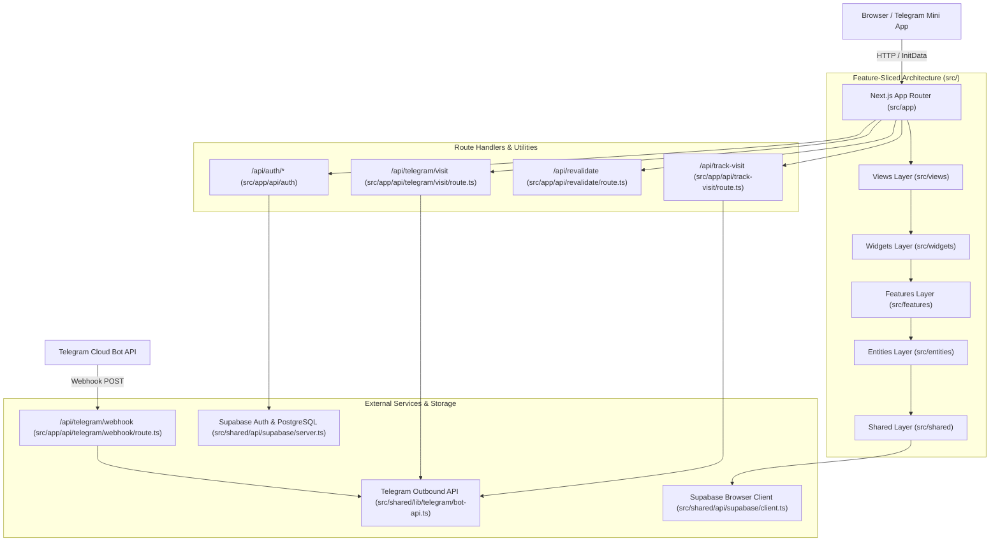

<!-- generated-by: gsd-doc-writer -->
# Architecture Overview

## System Overview

The Aliaksandr Bullo Personal Portfolio & Engineering Blueprint is a high-performance web application and interactive engineering showcase built on the Next.js 16 App Router and React 19. The application delivers verified production case studies, system architecture patterns, and technical competencies in an authentic Swiss / Constructivist typography aesthetic. Architectural responsibilities follow Feature-Sliced Design (FSD) conventions, separating low-level shared utilities and UI primitives from high-level composite views and business domain features. The system operates as a hybrid platform: static and server-rendered portfolio presentations, dynamic project deep dives via `src/app/projects/[slug]/page.tsx`, an administrative content management portal backed by Supabase with Row-Level Security, and a Telegram Bot / Mini App integration for live visitor tracking, lead forwarding, and direct engagement.

## Component Diagram

## Data Flow

1. **Portfolio Request Flow**: When a visitor accesses the root path (`/`) or project details (`/projects/[slug]`), Next.js Server Components evaluate layout and route metadata. Localized resume copy and core project data are fetched directly from typed records in `src/data/resume-data.ts`, while dynamic case studies or overrides query Supabase PostgreSQL via `src/shared/api/supabase/server.ts`.
2. **Visitor & Referral Tracking Flow**: When a user arrives with a referral parameter (e.g., `?ref=linkedin`), the client or browser triggers `GET /api/track-visit?ref=...`. The handler parses headers (User-Agent, CF/Vercel IP country), filters automated web crawlers, and forwards an HTML-formatted notification to the owner's Telegram chat via `src/shared/lib/telegram/bot-api.ts`.
3. **Telegram Mini App Interaction Flow**: Inside Telegram Mini App sessions, the client transmits Telegram `initData` to `POST /api/telegram/visit`. The handler validates the cryptographic HMAC-SHA256 signature against `TELEGRAM_BOT_TOKEN` in `src/shared/lib/telegram/verify-init-data.ts`. Upon verification, the event (view, CV download, or case share) is logged and notified to the owner.
4. **Administrative Authentication & CMS Flow**: Admin users authenticate via `POST /api/auth/login`, establishing an HTTP-only session cookie through `@supabase/ssr`. Subsequent requests to `/admin` pass through server-side role validation checking the `user_roles` table in PostgreSQL. Cache purges are executed through `POST /api/revalidate` with a secret bearer token.

## Key Abstractions

- `getSupabaseServerClient`: Factory creating an authenticated SSR Supabase client utilizing Next.js cookies (`src/shared/api/supabase/server.ts`).
- `getSupabaseBrowserClient`: Browser singleton client for client-side Supabase interactions (`src/shared/api/supabase/client.ts`).
- `verifyTelegramInitData`: Cryptographic HMAC validation function verifying Telegram WebApp `initData` integrity (`src/shared/lib/telegram/verify-init-data.ts`).
- `verifyCsrfOrigin`: CSRF guard enforcing standard Origin and Referer header verification on mutating route handlers (`src/shared/lib/csrf.ts`).
- `mapBackendError`: Normalized error response mapper translating database and service exceptions to clean JSON envelopes (`src/shared/lib/errors.ts`).
- `parseStartParam`: Decoder for Telegram deep linking payloads handling direct case navigation and referral tracking (`src/shared/lib/telegram/start-param.ts`).
- `resumeData`: Canonical typed static data object providing bilingual CV definitions, achievements, and technical stack details (`src/data/resume-data.ts`).

## Directory Structure Rationale

- `src/app/`: Next.js 16 App Router pages, layouts, global CSS styles, and route handlers (`/api`).
- `src/views/`: Screen-level compositions assembling widgets into full page experiences.
- `src/widgets/`: Independent, composite UI blocks such as Navigation, Hero, ProjectShowcase, and ExperienceTimeline.
- `src/features/`: User-driven interactive workflows such as authentication forms, language switching, and contact interactions.
- `src/entities/`: Domain models, data structures, and entity-specific presentation components.
- `src/shared/`: Shared cross-cutting modules including UI primitives (Radix UI wrappers), theme styles, Supabase clients, and Telegram utilities.
- `src/data/`: Centralized static data files including `resume-data.ts` and localization dictionaries.
- `src/context/`: React context providers managing client state such as active language and UI preferences.
- `netlify/functions/`: Serverless functions providing standalone fallback tracking (`netlify/functions/track-visit.js`).
- `scripts/`: Operational CLI scripts such as `scripts/set-webhook.mjs` for webhook management.
- `docs/`: Comprehensive project architectural, API, setup, and deployment guides.
